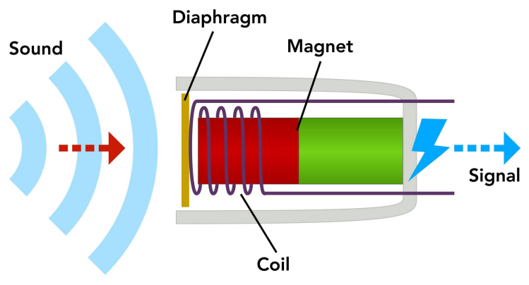
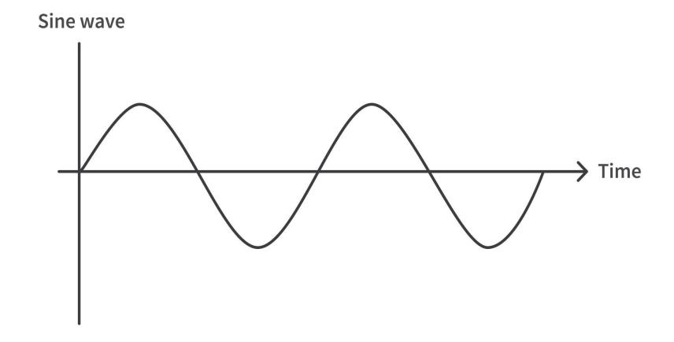
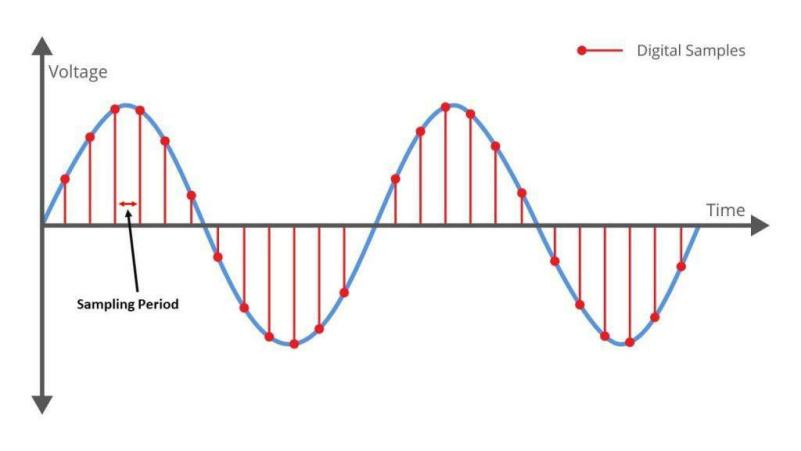
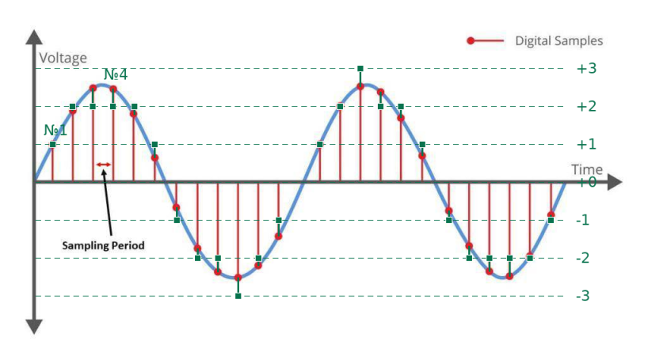

# ՀԱՅԱՍՏԱՆԻ ԱԶԳԱՅԻՆ ՊՈԼԻՏԵԽՆԻԿԱԿԱՆ ՀԱՄԱԼՍԱՐԱՆ 

**ԿԻՐԱՌԱԿԱՆ ՄԱԹԵՄԱՏԻԿԱՅԻ և ՖԻԶԻԿԱՅԻ ՖԱԿՈՒԼՏԵՏ**

**ԱՎԱՐՏԱԿԱՆ ԱՇԽԱՏԱՆՔ**

**ԱՌԱՋԻՆ ՏՈԿՈՍԱՎՈՐՈՒՄ**

**«ԱՆՕԴԱՉՈՒ ԹՌՉՈՂ ՍԱՐՔԵՐԻ ՊԱՍԻՎ ՀԱՅՏՆԱԲԵՐՈՒՄ ԵՎ ԴԱՍԱԿԱՐԳՈՒՄ ՍՊԵԿՏՐԱՅԻՆ ՎԵՐԼՈՒԾՈՒԹՅԱՄԲ»**

**ԽՈՒՄԲ ՝ ՄԹ 340**

**ՈՒՍԱՆՈՂ ՝ Հակոբյան Գայանե**

**ՂԵԿԱՎԱՐ ՝ Սերգո Եպիսկոպսյան**

**ԲՈՎԱՆԴԱԿՈՒԹՅՈՒՆ**

**1. Խնդրի դրվածք**

**1.1. Հետազոտության թեմայի արդիականությունը**

## 1.2. Հետազոտության կարևորությունը և գործնական նշանակությունը

## 1.3. Կիրառման ոլորտները

## 1.4. Հետազոտվող խնդրի նկարագրությունը

## 1.5. Հետազոտության նպատակը

## 1.6. Հետազոտության հիմնական խնդիրները

## 1.7. Ակնկալվող արդյունքները

**2. Ձայնի թվայնացումը**

## 2.1. Ակուստիկական ազդանշանի առաջացումը և բնութագրերը

## 2.2. Ձայնային ալիքից մինչև անալոգային էլեկտրական ազդանշան

### 2.3. Անալոգային ազդանշանի թվայնացումը

### 2.3.1. Նմուշառում (Sampling)

### 2.3.2. Քվանտացում (Quantization)

### 2.3.3. Կոդավորում (Encoding)

# 1. ԽՆԴՐԻ ԴՐՎԱԾՔԸ

## 1.1. Հետազոտության թեմայի արդիականությունը

Ժամանակակից տեխնոլոգիաների զարգացմանը զուգընթաց անօդաչու թռչող սարքերը լայն կիրառություն են ստացել տարբեր ոլորտներում։ Դրանց օգտագործման ընդլայնումը առաջ է բերում օդային տարածքի վերահսկման, շրջակա միջավայրում թռչող օբյեկտների հայտնաբերման և դրանց տեսակների տարբերակման անհրաժեշտություն։ Այս համատեքստում կարևոր նշանակություն ունի այնպիսի համակարգերի մշակումը, որոնք հնարավորություն կտան իրականացնել անօդաչու թռչող սարքերի պասիվ հայտնաբերում՝ առանց դրանց աշխատանքին անմիջական միջամտության։  
Պասիվ մոնիթորինգը հիմնվում է միջավայրում արդեն առկա ազդանշանների դիտարկման վրա՝ առանց դիտարկվող սարքին կառավարման հրամաններ ուղարկելու։

## 1.2. Հետազոտության կարևորությունը և գործնական նշանակությունը

Անօդաչու թռչող սարքերի հայտնաբերման հուսալիությունը կախված է ոչ միայն ձայնային ազդանշանի ուժգնությունից, այլև դրա ժամանակային և սպեկտրային կառուցվածքից, ինչպես նաև արտաքին աղմուկի ազդեցությունից։ Հետևաբար կարևոր է մշակել այնպիսի մոտեցում, որը համադրում է ազդանշանի տարբեր, միմյանց լրացնող հատկանիշներ և հնարավորություն է տալիս գնահատել հայտնաբերման արդյունքի վստահելիությունը։  
Հետազոտության գործնական նշանակությունը պայմանավորված է այնպիսի ծրագրային համակարգերի մշակման անհրաժեշտությամբ, որոնք կարող են իրականացնել անօդաչու թռչող սարքերին բնորոշ ազդանշանների վերլուծություն և նպաստել դրանց տարբերակմանը շրջակա միջավայրի այլ ձայնային աղբյուրներից։ Ֆուրիեի, Ուոլշ–Հադամարի և Հաարի փոխակերպումների համատեղ ուսումնասիրությունը հնարավորություն կտա գնահատել տարբեր սպեկտրային հատկանիշների տեղեկատվական նշանակությունը և դրանց կիրառելիությունը պասիվ հայտնաբերման ու դասակարգման խնդիրներում։

## 1.3. Կիրառման ոլորտները

Անօդաչու թռչող սարքերի պասիվ հայտնաբերման և դասակարգման համակարգերը կարող են կիրառվել օդային տարածքի պաշտպանական մոնիթորինգում, օդանավակայանների անվտանգության ապահովման, կարևոր ենթակառուցվածքների վերահսկման, արդյունաբերական օբյեկտների պաշտպանության, սահմանափակ տարածքների դիտարկման, ինչպես նաև քաղաքացիական անվտանգության համակարգերում։ Նման համակարգերի կիրառումը կարող է նպաստել դիտարկվող տարածքներում անսովոր ազդանշանային ակտիվության հայտնաբերմանը և անվտանգության վերահսկման արդյունավետության բարձրացմանը։

## 1.4. Հետազոտվող խնդրի նկարագրությունը

Անօդաչու թռչող սարքերի հայտնաբերման հնարավոր մոտեցումներից է դրանց աշխատանքի ընթացքում առաջացող ակուստիկական և ռադիոհաճախականային ազդանշանների ուսումնասիրությունը։ Թռչող սարքի շարժիչների և պտուտակների աշխատանքը կարող է առաջացնել բնորոշ ձայնային տատանումներ, որոնք պարունակում են պարբերական բաղադրիչներ, տարբեր հաճախականություններ և ժամանակի ընթացքում փոփոխվող առանձնահատկություններ։

Սակայն իրական պայմաններում ստացված ազդանշանները հաճախ պարունակում են շրջակա միջավայրի և չափիչ սարքավորումների առաջացրած աղմուկ։ Քամին, տրանսպորտային միջոցները, արդյունաբերական սարքավորումները և այլ ձայնային աղբյուրներ կարող են դժվարացնել անօդաչու թռչող սարքին բնորոշ ազդանշանների առանձնացումը։ Հետևաբար միայն ազդանշանի ամպլիտուդի կամ էներգիայի գնահատումը միշտ չէ, որ բավարար է հուսալի հայտնաբերման և դասակարգման համար։

Դիտարկվող ակուստիկական ազդանշանը կարելի է ներկայացնել հետևյալ պարզեցված մոդելով․

$y(t)=s_{obj}(t)+n_{env}(t)+n_{sensor}(t)$ **(1.1)**

որտեղ $y(t)$-ն խոսափողով գրանցված ընդհանուր ազդանշանն է, $s_{obj}(t)$-ն՝ դիտարկվող օբյեկտի ձայնային բաղադրիչը, $n_{env}(t)$-ն՝ շրջակա միջավայրի աղմուկը, իսկ $n_{sensor}(t)$-ն՝ չափիչ սարքավորման սեփական աղմուկը։ Մոդելը ցույց է տալիս, որ իրական ձայնագրությունից ԱԹՍ-ին բնորոշ հատկանիշների առանձնացումը ոչ միշտ է պարզ խնդիր։

Նշված խնդրի լուծման նպատակով անհրաժեշտ է ուսումնասիրել ազդանշանների ժամանակային և սպեկտրային կառուցվածքը՝ կիրառելով մաթեմատիկական մշակման տարբեր մեթոդներ։ Մասնավորապես, Ֆուրիեի փոխակերպումը հնարավորություն է տալիս ուսումնասիրել ազդանշանի հաճախականային բաղադրիչները, դրանց փոփոխությունը ժամանակի ընթացքում, Ուոլշ–Հադամարի փոխակերպումը՝ ազդանշանի կառուցվածքային առանձնահատկությունները, իսկ Հաարի փոխակերպումը՝ տեղային և կարճատև փոփոխությունները։

## 1.5. Հետազոտության նպատակը

Սույն աշխատանքի հիմնական խնդիրն է ուսումնասիրել և մշակել անօդաչու թռչող սարքերի պասիվ հայտնաբերման և դասակարգման ծրագրային մոտեցում, որը հիմնված կլինի ակուստիկական և ռադիոհաճախականային դիտարկումների սպեկտրային հատկանիշների համադրման վրա։

## 1.6. Հետազոտության հիմնական խնդիրները

• Ուսումնասիրել ԱԹՍ-ի ակուստիկական և պասիվ ռադիոհաճախականային դիտարկումների առանձնահատկությունները։

• Իրականացնել ձայնային ազդանշանի թվայնացում և նախնական մշակում։

• Հաշվարկել Fourier/FFT, STFT, Walsh–Hadamard և Haar հատկանիշները։

• Համեմատել հատկանիշների տեղեկատվականությունը և դրանց համադրման արդյունքները։

• Գնահատել հայտնաբերման և դասակարգման արդյունքները, այդ թվում՝ աղմուկի պայմաններում։

• Իրականացնել Python ծրագրային նախատիպ և ներկայացնել փորձարարական արդյունքները։

## 1.7. Ակնկալվող արդյունքները

Աշխատանքի ակնկալվող արդյունքը Python ծրագրավորման լեզվով իրականացված փորձարարական համակարգն է, որը հնարավորություն կտա վերլուծել մուտքային ազդանշանները, ներկայացնել դրանց սպեկտրային բնութագրերը և ձևավորել դիտարկվող աղբյուրի վերաբերյալ դասակարգման ու վստահելիության գնահատականներ։

Առաջին փուլի շրջանակում իրականացվել է ձայնային ազդանշանի թվայնացման ծրագրային նախատիպը։ Ծրագիրը և դրա գործարկման արդյունքները նախատեսվում է առանձին ցուցադրել GitHub նախագծի միջոցով։ Հետագա փուլերում նախատեսվում է անցնել սպեկտրային հատկանիշների հաշվարկին և դասակարգման փորձերին։

# 2. ՁԱՅՆԻ ԹՎԱՅՆԱՑՈՒՄԸ

Անօդաչու թռչող սարքի (ԱԹՍ) ձայնը համակարգչով վերլուծելու համար այն նախ պետք է ներկայացնել թվային ձևով։ Դիտարկենք պարզ օրինակ։ ԱԹՍ-ն թռչում է, իսկ տեղադրված խոսափողը գրանցում է նրա պտուտակների և շարժիչների ձայնը։ Ի՞նչ է տեղի ունենում պտուտակի շարժումից մինչև այն պահը, երբ համակարգիչը ձայնագրության ֆայլից կարդում է առաջին թիվը։

## 2.1. Ակուստիկական ազդանշանի առաջացումը և բնութագրերը

Երբ անօդաչու թռչող սարքի պտուտակի թիակը շարժվում է օդի միջով, այն փոխում է իր շրջակայքի օդի հոսքն ու ճնշումը։ Ճնշման փոփոխությունն ազդում է օդի հարևան շերտերի վրա և աստիճանաբար տարածվում մինչև խոսափողը։ Խոսափողի մոտ օդի ճնշումը մի պահ բարձրանում է, հաջորդ պահին՝ նվազում։ Օդում տարածվող այդ ճնշման տատանումն է ձայնային ալիքը։

Քանի որ պտուտակի թիակները պարբերաբար անցնում են նույն դիրքով, դրանց առաջացրած ճնշման փոփոխությունների մի մասը նույնպես կրկնվում է։ Հաճախականությունը ցույց է տալիս, թե տատանումը մեկ վայրկյանում քանի ամբողջ կրկնություն է կատարում։ Այն չափվում է հերցերով (Հց)։ Օրինակ՝ 200 Հց հաճախականությամբ բաղադրիչը մեկ վայրկյանում կրկնվում է 200 անգամ։ Իրական ԱԹՍ-ի ձայնը մի քանի բաղադրիչների համադրություն է, և պտուտակների արագության փոփոխության հետ կարող են փոխվել նաև այդ բաղադրիչների հաճախականությունները։

## 2.2. Ձայնային ալիքից մինչև անալոգային էլեկտրական ազդանշան

Խոսափողի ներսում կա բարակ, զգայուն թաղանթ։ Երբ ձայնային ալիքը հասնում է խոսափողին, օդի ճնշման փոփոխությունները շարժում են թաղանթը։ Երբ ձայնային ալիքի պատճառով խոսափողի մոտ օդի ճնշումը բարձրանում է, այն թաղանթը մի փոքր հրում է։ Երբ ճնշումը նվազում է, թաղանթը շարժվում է հակառակ ուղղությամբ։ Քանի որ դրոնի ձայնի պատճառով ճնշումը շարունակ փոխվում է, թաղանթն էլ սկսում է շատ փոքր շարժումներով հետ ու առաջ գնալ՝ տատանվել։

*Նկար 2.1. Ձայնային սենսորի կառուցվածքը և աշխատանքի սկզբունքը։*

Դինամիկ խոսափողի ներսում կա մագնիս և կոճ ,որը բարակ մետաղալարից բազմաթիվ պտույտներով փաթաթված լար է։ Երբ ձայնային ալիքները հասնում են խոսափողին, օդի ճնշման փոփոխությունների հետևանքով թաղանթը սկսում է տատանվել։ Թաղանթին միացված է կոճը, որը նույնպես շարժվում է մագնիսի մագնիսական դաշտում։Երբ կոճը շարժվում է մագնիսական դաշտում,նրա մետաղալարում առաջանում է էլեկտրական լարում։ Այս երևույթը կոչվում է էլեկտրամագնիսական ինդուկցիա։ Քանի որ ձայնի ազդեցությամբ կոճը շարժվում է առաջ և հետ, առաջացած էլեկտրական լարումը նույնպես անընդհատ փոփոխվում է։

Այսպիսով, խոսափողը ձայնային ալիքների մեխանիկական տատանումները վերածում է **փոփոխվող էլեկտրական լարման**, որն այնուհետև փոխանցվում է սարքին՝ մշակմանև թվայնացման համար։

Լարումը էլեկտրական շղթայի երկու կետերի միջև պոտենցիալների տարբերությունն է և չափվում է վոլտերով։ Այս դեպքում կարևոր է հետևել, թե խոսափողի ելքային լարումն ինչպես է փոխվում ժամանակի ընթացքում։ Օրինակ՝ դրոնի ձայնի կրկնվող բաղադրիչին խոսափողի ելքում կարող է համապատասխանել լարման կրկնվող փոփոխություն։ Այդ փոփոխվող լարումն էլ անվանում ենք էլեկտրական ազդանշան։ Լարումը ներկայացվում է որպես անալոգային (անընդհատ փոփոխվող) ազդանշան, քանի որ այն շարունակական է ժամանակի մեջ և կարող է ընդունել միջանկյալ արժեքներ։

## 2.3. Անալոգային ազդանշանի թվայնացումը

Շարունակական լարումից թվերի հաջորդականություն ստանալու համար ձայնագրման սարքում օգտագործվում է անալոգաթվային փոխարկիչ (Analog-to-Digital Converter, ADC)։ Ձայնային ազդանշանի թվայնացման համար կիրառվում է իմպուլսակոդային մոդուլյացիայի (PCM Pulse Code Modulation) մեթոդը, որը ներառում է անալոգային ազդանշանի նմուշառման, քվանտացման և երկուական կոդավորման հաջորդական փուլերը։

### 2.3.1. Նմուշառում (Sampling)

**Նմուշառումը (Sampling)** անալոգային ազդանշանի արժեքները որոշակի, հավասար ժամանակային ընդմիջումներով չափելու գործընթացն է։ Ձայնային ազդանշանի դեպքում նմուշառման ընթացքում գրանցվում են խոսափողից ստացված էլեկտրական ազդանշանի լարման արժեքները՝ ժամանակի առանձին պահերին։Նմուշառման գործընթացը կարելի է պատկերացնել անալոգային ազդանշանի գրաֆիկի միջոցով, որտեղ հորիզոնական առանցքը ներկայացնում է ժամանակը, իսկ ուղղահայաց առանցքը՝ լարման արժեքը։ Ժամանակային առանցքի վրա ընտրվում են հավասարաչափ բաշխված կետեր, և յուրաքանչյուր կետին համապատասխանող պահին որոշվում է ազդանշանի լարման արժեքը։ Այդ պահին գրանցված արժեքը կոչվում է նմուշ։

Նմուշառման հաճախականությունը՝ $f_{s}$, մեկ վայրկյանում վերցվող նմուշների քանակն է։ Նմուշառման ժամանակամիջոցը՝ $T_{s}$, երկու հարևան նմուշների միջև անցնող ժամանակն է։ Դրանց կապը հետևյալն է․

$T_s = \\frac{1}{f_s}$ **(2.1)**

Եթե անալոգային ազդանշանը x(t) է, ապա հավասարաչափ նմուշառման արդյունքում ստացվում է $x\lbrack n\rbrack = x(nT_{s})$, որտեղ n-ը նմուշի հերթական համարն է։

$x[n] = x(nT_s) = x\\left(\\frac{n}{f_s}\\right)$ **(2.2)**

Անալոգային ազդանշանի թվայնացման ընթացքում կարևոր նշանակություն ունի նմուշառման ժամանակամիջոցի ճիշտ ընտրությունը։ Ենթադրենք՝ տրված է սահմանափակ սպեկտրով անալոգային ազդանշան, որի առավելագույն հաճախությունը $f_{m}$ է։ Համաձայն Նայքվիստի չափանիշի՝ ազդանշանի ճշգրիտ վերականգնման համար նմուշառման ժամանակամիջոցը պետք է բավարարի հետևյալ պայմանին՝

$T_s \\leq \\frac{1}{2f_m}$ **(2.3)**  
որտեղ $T_{s}$-ը երկու հաջորդական նմուշների միջև ժամանակամիջոցն է, իսկ $f_{m}$-ը՝ ազդանշանի սպեկտրի առավելագույն հաճախությունը։

Քանի որ նմուշառման հաճախականությունը որոշվում է $f_{s} = \frac{1}{T_{S}}$ բանաձևով, Նայքվիստի պայմանը կարելի է ներկայացնել նաև հետևյալ տեսքով՝  
$f_s \geq 2f_m$ **(2.4)**

Այսպիսով, նմուշառման հաճախականությունը պետք է առնվազն երկու անգամ մեծ լինի ազդանշանի առավելագույն հաճախությունից։  
Նայքվիստի պայմանի պահպանումը թույլ է տալիս անալոգային ազդանշանը նմուշառելուց հետո վերականգնել առանց տեղեկատվության կորստի։

Այսպիսով, նմուշառման արդյունքում անընդհատ ժամանակում փոփոխվող անալոգային ազդանշանը ներկայացվում է առանձին ժամանակային պահերին համապատասխանող նմուշների հաջորդականությամբ։

Դիցուք ունենք այսպիսի անալոգային ազդանշան.

*Նկար 2.2. Անալոգային ձայնային ազդանշանի ժամանակային ներկայացումը։*

Սարքը ժամանակի ընթացքում վերցնում է ազդանշանի առանձին նմուշներ։

*Նկար 2.3. Անալոգային ազդանշանի նմուշառման գործընթացը։*

Յուրաքանչյուր կարմիր կետ ցույց է տալիս տվյալ պահին չափված լարման արժեքը։

Նմուշառման հաճախականությունը ցույց է տալիս, թե վայրկյանում քանի նմուշ է վերցվում,այսինքն քանի անգամ է սարքը չափում ազդանշանը։ Եթե այն 16,000 Հց է, ապա մեկ խոսափողով գրանցված մեկ վայրկյան ձայնին համապատասխանում է 16,000 նմուշ։ Հաջորդական երկու նմուշների միջև անցնում է 1/16,000 վայրկյան կամ 62.5 միկրովայրկյան։

Ձայնի հաճախականությունը և նմուշառման հաճախականությունը կարող են երկուսն էլ արտահայտվել հերցերով, բայց նկարագրում են տարբեր գործողություններ։ Օրինակ՝ 200 Հց ձայնային բաղադրիչը վայրկյանում կատարում է 200 կրկնություն, մինչդեռ 16 000 Հց նմուշառման դեպքում սարքը նույն վայրկյանում կատարում է 16 000 չափում։ Ուստի տվյալ բաղադրիչի մեկ կրկնության ընթացքում վերցվում է 16,000/200=80 նմուշ։

### 2.3.2. Քվանտացում (Quantization)

Քվանտացումը անընդհատ արժեքների վերածումն է վերջավոր քանակի արժեքների մոտարկման գործողության միջոցով։ Քվանտացում նշանակում է յուրաքանչյուր նմուշի արժեքը փոխարինել իրեն ամենամոտ թույլատրելի մակարդակով։

Ազդանշանի առավելագույն և փոքրագույն արժեքների տարբերությունը **դինամիկ տիրույթն** է ,որը տրոհելու ենք թույլատրելի մակարդակների,որպեսզի իրականացնենք քվանտացման գործողություն։  
Դինամիկ տիրույթը բաժանվում է ամպլիտուդային մակարդակների $q_{k}\ $քայլով ,որտեղ $k = 1,2,\ldots L$:  
$L$-ը հաստատուն է, որպես կանոն 2-ի աստիճանով$L = 2^{k}$ ,որտեղ k-ն բիթերի քանակն է որով ներկայացվում է մակարդակը։  
Օրինակ ՝ եթե դինամիկ տիրույթը բաժանել ենք 8 մակարդակների $Լ = 8 = 2^{3}$ ,ապա անհրաժեշտ է 3 բիթ յուրաքանչյուր մակարդակը բինար կոդով ներկայացնելու համար։

Չափված լարումը կարող է ընկնել այն երկու մակարդակների միջև, որոնք սարքը կարող է ներկայացնել թվային ձևով։ Պատկերացնենք քանոն, որի վրա նշված են միայն ամբողջ բաժանումները։ Եթե ցուցիչը կանգնել է 2.7-ի մոտ, գրանցում ենք մոտակա բաժանումը՝ 3-ը։ Նույն կերպ, եթե չափված արժեքը պայմանական սանդղակով (−2.7) է, այն ներկայացնում ենք (−3)-ով։ Բացասական նշանը նշանակում է, որ այդ պահին ազդանշանը շեղվել է ելակետային մակարդակից հակառակ ուղղությամբ։

*Նկար 2.4. Ազդանշանի քվանտացման գործընթացը։*

Կանաչ հորիզոնական գծերը ցույց են տալիս քվանտացման թույլատրելի մակարդակները։ Նկարում դրանք ընտրված են պայմանականորեն՝ գործընթացը տեսանելի դարձնելու համար։ Յուրաքանչյուր կարմիր կետին համապատասխան կանաչ քառակուսին դրված է ամենամոտ թույլատրելի մակարդակի վրա և ցույց է տալիս տվյալ նմուշի համար պահվող արժեքը։ Օրինակ՝ չորրորդ կարմիր կետը գտնվում է (+2) և (+3) մակարդակների միջև։ Քանի որ այն ավելի մոտ է (+2)-ին, տվյալ նմուշը ներկայացվում է (+2) արժեքով։Քվանտացման միջոցով անընդհատ փոփոխվող լարման արժեքները ներկայացնում ենք սահմանափակ թվով մակարդակներով։

Քվանտացման սխալը սկզբնական նմուշի և քվանտացումից հետո վերականգնված արժեքի տարբերությունն է։ Բիթային խորության ավելացումը սովորաբար նվազեցնում է այս սխալը, եթե մյուս պայմանները նույնն են։

### 2.3.3. Կոդավորում (Encoding)

Այս գործընթացը հնարավորություն է տալիս ձայնային ազդանշանը պահպանել համակարգչի հիշողության մեջ և հետագայում իրականացնել դրա թվային մշակումը։ Կոդավորման փուլում յուրաքանչյուր քվանտացված մակարդակ ներկայացվում է որոշակի երկարության երկուական կոդով։ Կոդի երկարությունը կախված է բիթային խորությունից (Bit Depth), որը որոշում է մեկ նմուշի ներկայացման համար օգտագործվող բիթերի քանակը։Իրական ձայնային համակարգերում հաճախ օգտագործվում է, օրինակ, 16-բիթանոց PCM կոդավորում։Այս դեպքում յուրաքանչյուր նմուշի քվանտացված թվային արժեքը ներկայացվում է 16 բիթով, ինչը հնարավորություն է տալիս տարբերակել՝ $2^{16} = 65536$ քվանտացման մակարդակ։ 16-բիթանոց PCM ներկայացման դեպքում նմուշների թվային արժեքները սովորաբար գտնվում են \[-32768,32767\] միջակայքում։ Դրական և բացասական արժեքները ներկայացվում են երկուական կոդերով, իսկ բացասական թվերի համար օգտագործվում է լրացուցիչ կոդի (Two's Complement) եղանակը։

Օրինակ՝ եթե քվանտացումից հետո նմուշի թվային արժեքը հավասար է 1000-ի, ապա դրա 16-բիթանոց երկուական ներկայացումը կլինի՝$\ 1000_{10} = 0000001111101000_{2}$ :Այս երկուական կոդը ներկայացնում է ձայնային ազդանշանի մեկ նմուշը։ Հաջորդ նմուշների համար նույնպես ձևավորվում են համապատասխան կոդեր:

Ստացված երկուական կոդերի հաջորդականությունը ձևավորում է թվային ձայնային տվյալները, որոնք կարող են պահպանվել WAV(Waveform Audio File Format) ձևաչափով և օգտագործվել հետագա ազդանշանային վերլուծության համար։

Այսպիսով, ձայնը թվայանցվեց, և ստացված թվային ազդանշանի նկատմամբ հնարավոր է կիրառել Ֆուրիեի , Ուոլշ–Հադամարի և Հաարի ձևափոխությունները՝ ուսումնասիրելու դրա հաճախականային և կառուցվածքային առանձնահատկությունները։
